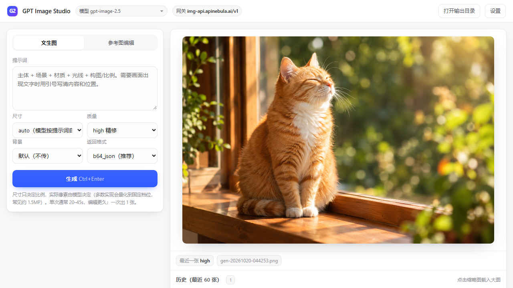
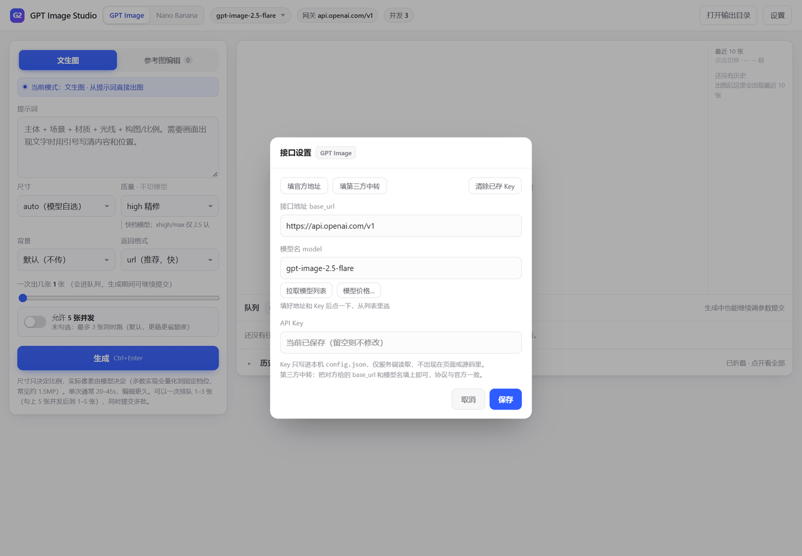

# GPT Image Studio

**本地生图工作台 · 自带 API Key · 同时支持 OpenAI Images 与 Gemini 图像模型**

一个单文件就能跑起来的本地 Web 工作台：左边写提示词，右边出图，图自动落盘。
支持文生图和参考图编辑，前端零构建、后端零依赖，附带 ComfyUI 节点。



---

## 特性

- **零依赖**：只用 Python 标准库。不需要 `pip install`，官方 CPython / Windows 嵌入式版 / ComfyUI 内置 Python 都能直接跑
- **自带 Key**：直连官方，或任何同协议的第三方中转，不经过第三方计费
- **两套接口，一键切换**：左上角在 **GPT Image**（`/images/generations` + `/images/edits`）和 **Nano Banana**（Gemini 图像模型的 `/chat/completions`）之间切，模型列表、参数面板、价格显示一起换
- **模型带价格，价格能自己改**：下拉里直接标出每个模型每次多少钱；模型不用了、换了新模型，都在「价格…」里自己填，拉取列表时已下架的模型价格会自动清掉
- **拖到哪儿都行**：图片拖进窗口任意位置即可当参考图，不用瞄准那个小方框；文生图模式下会自动切到「参考图编辑」。Ctrl+V 粘贴同理
- **右侧最近 10 张**：图片显示区右边竖排两列最近结果，来回切换对比不用往下翻；`←` `→` 也能翻
- **历史默认折叠**：最近 60 张还在，只是不再占满页面，需要时点开
- **打开就是干净的**：不会自动把上一张图顶到画布上
- **批量与队列**：默认 **3 路并发**、一次最多排 3 张；勾选「允许 5 张并发」才放开到 5 路。生成期间可以继续改参数提交，新任务进队列不打断前面的
- **本地留存**：图片存 `outputs/`，同名 `.json` 记录提示词、模型、参数和耗时
- **密钥不出机器**：Key 只写进本机 `config.json`，仅服务端读取，不会出现在页面、前端源码或日志里
- **可打包成便携版**：内置 Python 运行时，拷到 U 盘双击即用，目标机不需要装任何东西

## 快速开始

### 方式一：源码运行（需要 Python 3.9+）

```bash
git clone https://github.com/AaronShawn/gpt-image-studio.git
cd gpt-image-studio
python studio/server.py --open
```

浏览器会打开 `http://127.0.0.1:8756`。首次运行会自动弹出设置面板：



填三项就能用。**不确定模型名怎么写？** 填好地址和 Key 后点「拉取模型列表」，
程序会请求该网关的 `/v1/models`，直接把可用的模型名列出来给你选。

| 字段 | 说明 | 例子 |
|---|---|---|
| 接口地址 `base_url` | 到 `/v1` 为止 | `https://api.openai.com/v1` |
| 模型名 `model` | 对方文档给的模型 ID | `gpt-image-2.5-flare` |
| API Key | 你的密钥 | `sk-...` |

两套接口的地址、Key、模型分开保存：在左上角切到哪一套，设置里改的就是哪一套。
端口被占用会自动往后顺延，控制台会打印真实地址。

### 方式二：Windows 便携版

到 [Releases](../../releases) 下载 `gpt-image-studio-*-win64.zip`，解压后双击 `launch.bat`。
包内自带 Python 3.12 运行时，不需要安装任何东西。

### 方式三：ComfyUI 节点

把 `comfyui/ComfyUI-GPTImageStudio` 整个文件夹复制到 `ComfyUI/custom_nodes/`，重启 ComfyUI，
节点库搜索 `GPT Image`，出现「文生图」和「参考图编辑」两个节点。

## 界面速览

| 位置 | 作用 |
|---|---|
| 左上「GPT Image / Nano Banana」 | 切换接口。模型列表、参数面板、配色一起换 |
| 模型下拉 | 列出网关 `/v1/models` 返回的模型；有价格的会显示 `¥x.xx/次`。底部「价格…」可以自己改 |
| 右上「设置」 | 当前接口的 base_url / 模型 / Key，「拉取模型列表」也在这里 |
| 中间画布 | 显示当前图，打开时是空的 |
| 画布右侧两列 | 最近 10 张，点一下就在画布上切换；`←` `→` 翻 |
| 底部「历史（最近 60 张）」 | 默认折叠，点标题展开，缩略图可删 |
| 左下「允许 5 张并发」 | 关 = 3 路，开 = 5 路，即时生效不用重启 |

## 模型与参数（重要）

**两族模型的切换逻辑不一样，不写清楚会踩坑，详见 [docs/models.md](docs/models.md)。** 摘要：

- **GPT Image 2 只有一个模型**：`gpt-image-2`，质量上限 `high`
- **GPT Image 2.5 有两个模型**：`gpt-image-2.5-flare`（快档，默认）和 `gpt-image-2.5-sunburst`（质档）。
  **切换参数就是 `model` 字段本身** —— 没有 `variant` / `tier` 之类的开关，改一个字符串即可；
  两者共用同一套参数，2.5 另外多两个质量档 `xhigh` / `max`
- 有些中转把两个 2.5 合成一个 `gpt-image-2.5`，那列表里就只有一项（网关行为，不是软件没做）
- **Nano Banana 是对话式接口**：没有独立的「编辑」端点，参考图是多模态输入的一部分；
  没有质量/背景参数；**画幅比例只能靠提示词**（网关通常不透传 `image_config`），
  界面上的比例选择器会把「画面比例 9:16」追加到你的提示词后面
- 模型后面的价格来自内置表或你自己填的值，**仅展示，不影响计费**；在模型下拉的「价格…」里随时改，
  拉取模型列表时会自动删掉已下架模型的价格（详见 [docs/models.md](docs/models.md#三价格是怎么来的怎么改)）

### GPT Image 参数

| 界面控件 | 接口字段 | 取值 | 作用 |
|---|---|---|---|
| 模式页签 | 决定端点 | `/images/generations`、`/images/edits` | 编辑模式才有参考图和保真度 |
| 提示词 | `prompt` | 文本 | 唯一决定画面内容的输入 |
| 参考图 | `image`（重复字段，文件上传） | ≤16 张 | 第一张是主体，顺序有意义 |
| 保真度 | `input_fidelity` | `high` / `low` | 高则尽量不动原图，低则允许重画 |
| 尺寸 | `size` | `auto` 或 `宽x高` | 只决定比例，实际像素由模型决定 |
| 质量 | `quality` | `low` / `medium` / `high` / `auto`（2.5 另有 `xhigh` / `max`） | 细节与耗时 |
| 背景 | `background` | 不传 / `opaque` / `transparent` | 透明背景输出带 alpha 的 PNG |
| 返回格式 | `response_format` | `url` / `b64_json` | 优先 `url`：实测某些网关的 `b64_json` 会慢 3 倍以上 |

**默认值**：尺寸 `auto`、质量 `high`、保真度 `high`、背景不传、返回 `url`。

### Nano Banana 参数

| 界面控件 | 实际作用 |
|---|---|
| 提示词 | 唯一决定画面的输入；编辑时写「改什么 + 保留什么」 |
| 参考图（可选） | 作为多模态内容一起发，≤14 张，第一张是主体 |
| 画幅比例 | 往提示词末尾追加一句「画面比例 9:16，竖版构图」 |
| 一次出几张 | 并行发 N 次请求，每张单独计费 |

### 关于速度

出图慢先看两件事，都跟软件没关系：

1. **`response_format`**：`b64_json` 会让网关把整张图 base64 内联进响应。实测同一个模型同一时刻，
   `url` 模式 30 秒返回、再花 30 秒从 CDN 下载；`b64_json` 要 **172 秒**。所以默认用 `url`，
   客户端拿到链接后自己下载（带重试）。
2. **时段**：同一把 Key 在凌晨 20–45 秒，晚高峰能到 180–240 秒，属于上游排队，不是客户端问题。

批量时程序默认 **3 路并发**（实测 3 张并行约等于 1 张的时间；串行则是 3 倍）。
5 路并发更吃上游额度、也更容易撞上网关限流，所以做成了左下角的勾选项。

### 关于手滑连点

- 提交按钮点下去会立刻变成「提交中…」并禁用，成功后再亮成绿色的「✓ 已提交 N 张」
- 就算真点了两次，服务端也会在 1.5 秒内把同一批（接口 + 模型 + 提示词 + 张数 + 尺寸 + 质量都一样）合并成一单

### 关于分辨率

`size` 只影响**画面比例**，不是精确像素。多数图像模型会把输出量化到固定像素档位
（常见约 1.5 MP），不同服务商、不同计费档的档位不一样。填 `3840x2160` 不一定真给你 4K，
有些网关按分组限死 1K（选 2048 也回 1254×1254）。判断真实尺寸请看图片文件本身，而不是响应里的 `size` 字段。

小技巧：
- 竖版用标准值（如 `1080x1920`），短边太小的尺寸可能被服务端丢弃并回退到默认横版
- 先 `quality=low` 试构图，定了再 `high` 重跑同一段提示词
- 2.5 两个模型对比时，只改模型、别改提示词，不然比不出来

## 目录结构

```
gpt-image-studio/
├─ studio/
│  ├─ server.py          # 本地 HTTP 服务（标准库）
│  └─ index.html         # 单页界面（无框架、无构建）
├─ core/
│  └─ image_api.py       # 接口客户端：generate / edit / nano_chat / save
├─ comfyui/
│  └─ ComfyUI-GPTImageStudio/   # ComfyUI 自定义节点
├─ tools/
│  └─ build_portable.py  # 打包免安装 Windows 便携版
└─ docs/
   ├─ models.md          # 模型与参数说明（必读）
   ├─ screenshot.png
   └─ settings.png
```

## HTTP 接口

浏览器和本地服务之间就这几个端点，想接自己的脚本直接调：

| 端点 | 作用 |
|---|---|
| `GET /api/config` | 当前配置（Key 只回 `has_key` / 打码值） |
| `POST /api/config` | 改配置：`{provider, base_url, model, api_key}` / `{max_parallel}` / `{provider, activate:true}` |
| `POST /api/models` | 拉模型列表：`{provider}`，返回 `{models:[{id,image}]}` |
| `POST /api/jobs` | 提交任务：`{provider, mode, prompt, count, model, images[], size, quality, ...}` |
| `GET /api/jobs` | 队列与进度 |
| `GET /api/history` | 最近 60 张（含同名 `.json` 里的参数） |

## 自己打包便携版

```bash
python tools/build_portable.py \
  --python-zip /path/to/python-3.12.8-embed-amd64.zip \
  --out dist
```

`python-*-embed-amd64.zip` 可从 python.org 或国内镜像（如
`https://mirrors.aliyun.com/python-release/windows/`）获取。脚本会组装 `runtime/ + app/ + 启动器` 并压成 zip。

## 常见问题

| 现象 | 原因 |
|---|---|
| 页面提示没有 API Key | 点右上角「设置」填好三项并保存（注意当前切的是哪套接口） |
| 400 / 模型不存在 | `model` 填错，必须是对方文档里的模型 ID |
| 403 该令牌无权访问模型 | 网关没给这把 Key 开这个模型，比如直填 `gpt-image-2.5-flare` |
| 图片一直转圈 | 单张通常 20–45 秒，编辑更久；超 3 分钟检查网络能否访问网关 |
| 返回的 `url` 打不开 | 部分网关的 CDN 校验 UA 或链接有有效期，改用 `b64_json` |
| Nano 比例不对 | 网关不透传 `image_config`，用提示词写比例 |
| 想让 ComfyUI 用官方积分节点 | 那个节点走 Comfy 账号计费，不支持自带 Key，与本项目无关 |

## 许可

[MIT](LICENSE)
